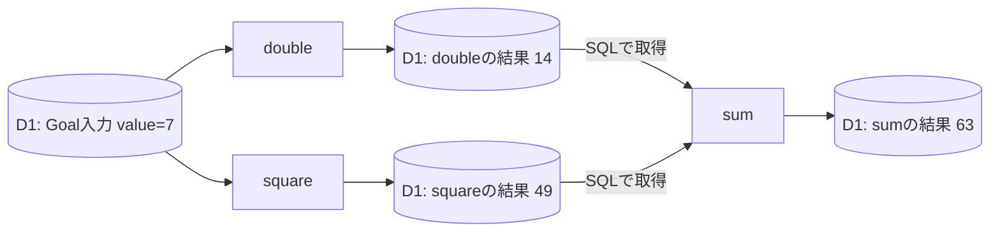

# cfordo example

## 目的

独立した工程がD1へ結果を保存し、後続工程がSQLでその結果を取得するexample。
`double`・`square`を並列実行し、その完了後に`sum`を実行する。

## 仕様

- 入力は`{ "value": 7 }`のような数値を持つJSON。
- `double`は入力を2倍、`square`は入力を2乗する。
- `double`と`square`を`parallel()`で実行する。両方の検証・評価が成功してから、`sum`が同じGoalの両結果をSQLで読み取って足す。
- `sum`の検証・評価まで成功するとGoalが完了する。先行工程が失敗した場合、`sum`は開始しない。
- 各工程の`run`・`validate`・`evaluate`は独立したQueue処理として実行され、正常時は計9件の実行記録がD1に保存される。
- `validate`は保存結果が有限の数値かを確認する。`evaluate`はそのGoalの入力やD1の保存結果から期待値を求めて比較する。
- サービスBinding経由で専用Workerの`POST /_ordo/goals`へJSONを送ると、HTTP 202と数値の`{ "goalId": 1 }`を返す。
- `GET /_ordo/goals`は入力・状態・工程別の結果を全件返す。`GET /_ordo/goals/:goalId`は各工程の`executions`も返す。
- `executions`はrun・validate・evaluateの処理履歴。再配信では増えず、業務上の再試行で増える。
- 公開URLは無効。サービスBindingから呼ぶ内部HTTP APIはOrdoに組み込まれたHonoを使用する。外部AI APIは使用しない。
- `setup()`に設定・工程を定義し、名前付きのWorkflowクラスと`ExampleWorkflow.worker()`を公開する。
- Binding名は`DB`・`QUEUE`・`WORKFLOW`に固定する。
- 起動入力は各処理で`ctx.input().params`から取得する。検証・評価の`ctx.input().result`は同じ工程のrunのD1保存結果。
- `sum`は`this.env.DB`のSQLで先行工程の保存結果を取得する。入力に追加のレコードIDは不要。既存のGoal IDで対象の実行を指定する。
- `run`は`await ctx.complete(data)`、検証・評価は`await ctx.ok()`・`await ctx.ng(reason)`で保存する。関数は値を返さない。
- 起動入力の`Params`と各工程の結果型を定義し、保存・読み取りの型を共有する。

### 工程間のデータ取得



`parallel()`の終了は先行工程の完了待ちであり、結果の受け渡しではない。
`sum`のrunは、同じGoalのdouble・squareの最新runが保存した結果をSQLで読み取り、足した値を保存する。
各工程のvalidate・evaluateも別のQueue処理として動き、同じ工程のrunの保存結果を`ctx.input().result`から取得する。
doubleとsquareのevaluateは起動入力から期待値を計算し、sumのevaluateは先行工程の結果をD1から再取得して照合する。入力値を固定せず、それぞれのGoalのデータで判定する。
工程間で戻り値やメモリ上の計算結果を共有せず、D1の保存結果を参照する。

SQLを含む利用例は[src/index.ts](src/index.ts)にある。この例ではOrdoの結果保存先を参照し、新しい業務テーブルや事前登録用のIDは追加しない。

| リソース | 名前                    |
| -------- | ----------------------- |
| Worker   | `example-ordo`          |
| D1       | `example-ordo-db`       |
| Workflow | `example-ordo-workflow` |
| Queue    | `example-ordo-queue`    |

## 開発環境

リポジトリルートのmise・pnpm設定を使用する。Wranglerはローカル設定で指定したアカウントにアクセスできる認証が必要。

Binding型は公開用設定例からWranglerが生成する`worker-configuration.d.ts`を使用する。設定を変更した場合は`pnpm --filter @cfordo/example types`で再生成する。Workflowは`Ordo<Env>`を継承したクラスで公開する。

D1は`remote: true`としており、開発時も指定したリモートDBへ接続する。
`wrangler.example.jsonc`は公開用の設定例で、実環境のAccount ID・DB IDを含めない。
初回に`wrangler.example.jsonc`を`wrangler.jsonc`へコピーし、自分の`account_id`を追加して`database_id`を設定する。
`wrangler.jsonc`はGit管理外。開発・デプロイではWranglerがこのファイルを標準で読み込む。CIでは同じファイルを非公開設定から用意する。
実IDを共通設定へ書き戻したり、Gitの`assume-unchanged`や`skip-worktree`を使ったりする必要はない。

## 開発方法

以下はリポジトリルートで実行する。

```sh
mise install
pnpm install --frozen-lockfile
cp example/wrangler.example.jsonc example/wrangler.jsonc
# example/wrangler.jsonc に自分のIDを記入
pnpm check
```

DBの初期化とマイグレーションは、Ordoが実行開始時に自動で行う。初期化コマンドの実行は不要。

ローカルの確認は`pnpm check`による型チェック・ビルドに限定する。
動作検証は本番へデプロイしたexampleに対して行い、ローカル実行を代替にしない。サービスBinding経由で以下を確認する。

- 入力7・11・23のGoalを並行して起動し、異なるGoal IDを返すこと。
- 全件一覧と1件取得で、入力・状態・工程別結果が一致すること。
- 正常時は各工程のrun・validate・evaluateが成功し、Goalごとに計9件の`executions`があること。
- sumが先行2工程の完了後に開始し、そのGoalのD1保存結果の和を返すこと。
- 入力`{ "value": 1e308 }`では非有限の結果を保存できず、例外の再試行上限でGoalが失敗し、理由と履歴を取得できること。sumの`executions`は0件であること。
- 不正JSON・不正IDは400、存在しないGoal IDは404を返すこと。
- 公開URLからはアクセスできず、サービスBinding経由で利用できること。

本番を呼び出す設定は`wrangler.caller.jsonc`に置く。`ORDO`はデプロイ済みの`example-ordo`を参照するサービスBindingで、`remote: true`を指定する。
`request`コマンドは`request.mjs`を実行し、Wranglerの認証済み接続からこのBindingを呼ぶ。Account IDはローカル専用の`wrangler.jsonc`から読み、呼び出し元設定には実IDを保存しない。
この設定にWorkerの実装は含めず、別のWorkerをデプロイする必要はない。業務処理・Queue・D1は本番のexampleを使用する。

```sh
# 一覧（引数なしでも同じ）
pnpm --filter @cfordo/example request GET /_ordo/goals
# 起動
pnpm --filter @cfordo/example request POST /_ordo/goals '{"value":7}'
# 返されたgoalIdで詳細取得（以下は1の場合）
pnpm --filter @cfordo/example request GET /_ordo/goals/1
```

引数はHTTPメソッド、パス、任意のJSON本文。HTTPステータスと本文を表示し、HTTPエラー時は終了コード1を返す。
通信セッションはリクエスト終了時に閉じる。`request`で起動したGoalの完了は、詳細取得で確認する。

検証で作成したGoalは本番DBに保存される。入力ごとの期待結果はdoubleが2倍、squareが2乗、sumがその和。
7なら14・49・63、11なら22・121・143、23なら46・529・575になる。

## デプロイ方法

```sh
pnpm --filter @cfordo/example run deploy
```

切り替え前に旧WorkflowとQueue処理の終了を確認する。現行のaction別スキーマからの更新ではDBのリセットは不要。

Workerのデプロイ時にWorkflowとQueue Consumerを設定する。`workers.dev`・プレビューURL・公開ルートは無効にする。
ローカルの実IDを使うWrangler操作には`pnpm --filter @cfordo/example exec wrangler <command>`を使う。

呼び出し元WorkerのWrangler設定に、次のサービスBindingを追加する。

```json
{ "services": [{ "binding": "ORDO", "service": "example-ordo" }] }
```

呼び出し元から起動・取得する。`ORDO`の型は`Fetcher`。URLのホスト名は公開先ではなく、通信先はBindingが決める。

```ts
const response = await env.ORDO.fetch("https://ordo/_ordo/goals", {
  method: "POST",
  headers: { "Content-Type": "application/json" },
  body: JSON.stringify({ value: 7 }),
});
const { goalId } = await response.json<{ goalId: number }>();
const list = await env.ORDO.fetch("https://ordo/_ordo/goals");
const detail = await env.ORDO.fetch(`https://ordo/_ordo/goals/${goalId}`);
```

入力7なら`double`の`output`は`{ "value": 14 }`、`square`は`{ "value": 49 }`、`sum`は`{ "value": 63 }`になる。
Goalと3工程の`status`が`completed`であり、検証・評価が成功していることを確認する。
一覧は全件をGoal ID降順で返す。詳細の各工程には正常時3件ずつ、計9件の`executions`を含む。

日時はUnix時刻のミリ秒。不正なJSON・IDは400、不存在は404、起動確認・状態照会の障害は503を返す。
起動確認が503でも`goalId`が返った場合は、そのGoalを照会する。再POSTは新しいGoalを作る。
業務上の失敗・期限切れでも取得に成功すれば200であり、JSONの`status`と`error`を確認する。
